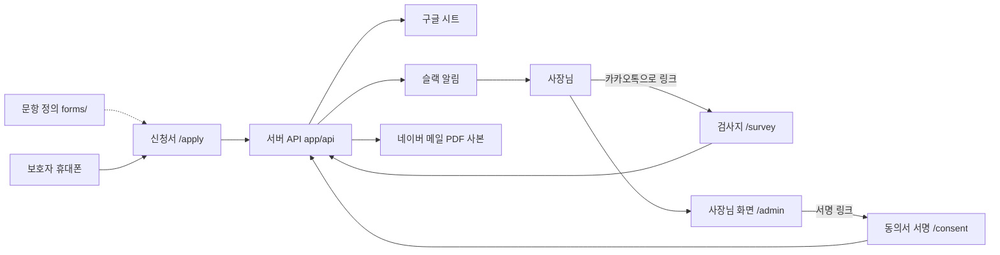

# 히스하우스 예약 신청서

반려동물 미용 매장 히스하우스의 보호자가 휴대폰으로 예약 신청서와 행동 분석 검사지를 쓰고 교육미용 동의서에 서명하는 웹입니다. 매장 사장님은 들어온 신청을 구글 시트와 슬랙으로 받습니다.

사이트: <https://hisshaus-form.vercel.app/hisshaus> | 상태: 운영 중 (매장 손님이 실제로 쓰고 있습니다)

## 한눈에 보기

| 항목 | 내용 |
|---|---|
| 기간 | 2026-10-23 ~ 2026-11-03 (main 브랜치 첫 커밋과 마지막 커밋) |
| 인원과 역할 | 1명. 매장 사장님과 문항과 화면을 정하고, Claude Code로 설계부터 테스트까지 진행 |
| 상태 | 운영 중 (Vercel 배포) |
| 주요 기술 | Next.js 16, React 19, TypeScript, 구글 Sheets API, 슬랙 웹훅, pdf-lib, nodemailer, Vitest, Playwright |

## 주요 기능

- 보호자는 로그인 없이 휴대폰에서 신청서를 한 화면씩 넘기며 씁니다. 고른 서비스(미용, 데이케어, 호텔, 교육미용)에 맞는 질문만 나오고, 쉬는 날인 화요일과 공휴일은 달력에서 고를 수 없습니다.
- 쓰다 만 내용은 같은 기기의 브라우저에 남아서, 다시 열면 이어서 쓸 수 있습니다.
- 신청이 들어오면 구글 시트에 한 줄이 쌓이고 사장님 슬랙으로 답변 전체가 갑니다. 따로 데이터베이스를 두지 않고 시트가 기록을 맡습니다.
- 교육미용 신청에는 행동 분석 검사지 링크가 붙습니다. 사장님이 예약금 입금을 확인한 뒤 카카오톡으로 보내고, 보호자가 제출하면 그 링크는 닫힙니다.
- 사장님 화면에서 교육미용 동의서를 만들어 링크로 보내거나, 매장 아이패드로 그 자리에서 받습니다. 보호자가 손가락으로 서명하면 서명이 찍힌 PDF가 매장 메일함과 보호자 메일로 갑니다.

## 구조



화면, 입력 검사, 시트의 열, 슬랙 메시지는 모두 `forms/` 의 문항 정의 한 곳을 읽습니다. 그래서 문항을 고치면 네 곳이 함께 바뀝니다. 서버는 검사, 시트 저장, 슬랙 전송 순서로 일합니다. 시트 저장이 실패하면 보호자에게 실패를 알리고, 슬랙만 실패하면 기록은 이미 남았으므로 성공으로 답합니다. 검사지와 동의서 링크에는 서버만 아는 비밀값으로 만든 서명이 붙어 있어서, 주소를 바꿔 다른 사람의 문서를 열 수 없습니다.

## AI와 함께 만든 방식

- 저장소의 `CLAUDE.md` 가 에이전트가 작업 전에 먼저 읽는 규칙입니다. 비밀값과 답변 내용을 로그에 남기지 않기, 시트에는 수식이 실행되지 않는 방식(`RAW`)으로만 쓰기, 검사지 질문은 원문 글자를 바꾸지 않기, 정해진 아홉 폴더 밖에 새 폴더를 만들지 않기, 유료가 될 수 있는 서비스를 더하기 전에 무료 한도부터 밝히기 같은 내용이 들어 있습니다.
- `docs/superpowers/` 에 설계와 문항, 판정 문서 5개(`specs/`)와 구현 계획 3개(`plans/`)가 있습니다. 신청서, 검사지 링크, 동의서 세 기능 모두 설계 문서를 먼저 쓰고, 계획 문서로 작업을 나눈 뒤 구현했습니다. 계획의 대부분 작업에는 실패하는 테스트를 먼저 확인하고 통과를 확인하는 단계가 적혀 있습니다.
- 계획을 서브에이전트로 실행하면서 사람 대신 내린 결정은 [판정 기록](docs/superpowers/specs/2026-10-24-hisshaus-form-rulings.md)에 "판정, 이유, 틀렸을 때 드는 비용" 순서로 남겼습니다. 틀린 판정은 이 문서를 근거로 되돌릴 수 있습니다.
- main 브랜치 커밋 113개 모두에 Claude 공동 작성자 줄이 있습니다.
- 사람이 정한 것은 커밋 메시지에 "사용자 결정" 또는 "사장님 결정"으로 표시했고, 이런 커밋이 15개입니다. 예를 들어 화면에 전체 문항 수나 진행 막대를 보이지 않기, 검사지는 사장님이 보낸 링크로만 열기, 영업시간과 휴무일이 여기에 해당합니다.

## 검증

- 단위와 컴포넌트 테스트는 Vitest 파일 44개, 실제 브라우저 테스트는 Playwright 파일 4개(신청서, 검사지, 동의서, 사장님 화면)입니다. 브라우저 테스트는 가짜 슬랙, 시트, 메일 서버(`tests/e2e/fake-services.mjs`)로만 보내서 진짜 서비스를 부르지 않습니다.
- 형 검사(`tsc --noEmit`)와 `pnpm build` 를 함께 돌립니다. CI는 없고 푸시하기 전에 로컬에서 돌립니다.
- 데이터가 원본과 같은지도 테스트로 봅니다. `tests/survey-verbatim.test.ts` 는 검사지 문항을 구글폼 원본 덤프(`tests/survey-original.txt`)와 글자 단위로 대조하고, 원본과 다른 곳은 사장님 결정으로 고친 목록에 있는 것만 허용합니다. 동의서는 칸 좌표를 원본 PDF의 글자 위치와 견주고, 원본 PDF가 바뀌었는데 장 그림을 다시 만들지 않으면 테스트가 실패합니다.
- 테스트와 검토로 잡은 AI 실수 예시입니다.
  - `5203ac2` 구현 중 신청서 문항 일부를 선택 문항으로 두고 라벨을 지어낸 것을 구글폼 원문대로 되돌렸습니다(판정 기록 1번).
  - `4a28cc9` 구글 토큰 요청이 시간 초과 때 라이브러리 재시도로 최악 30초까지 걸릴 수 있어서, 한 시도 5초로 줄이고 응답 없음은 재시도하지 않게 했습니다(판정 기록 10번).
  - `8219a3f` 단위 테스트(jsdom)에서는 통과했지만 실제 브라우저에서는 뒤로 가기를 눌러도 화면이 그대로인 문제를 찾았습니다. 고치기 전 실패를 재현하는 테스트를 더하고 크로미움에서 직접 확인했습니다.

## 비용

외부 서비스 다섯(Vercel, 구글 Sheets API, 슬랙, 공공데이터포털 공휴일 API, 네이버 메일)을 쓰고, 지금 규모에서는 모두 무료입니다. 서비스마다 유료로 바뀌는 지점을 찾아 표로 정리했습니다. 예를 들어 Vercel 무료 요금제는 약관상 비상업용이라 문제가 되면 옮길 곳을 정해 두었고, 동의서 PDF가 쌓이는 메일함 용량은 가장 나쁜 경우 약 3년을 버틴다고 계산했습니다. 전체 표는 [docs/OPERATIONS.md](docs/OPERATIONS.md#비용)에 있습니다.

## 시작하기

Node.js 24 LTS(22.22.2 이상의 22.x도 됨)와 pnpm 11을 권합니다.

```bash
pnpm install
cp .env.example .env.local   # 값 채우는 방법은 docs/SETUP.md
pnpm dev                     # http://localhost:3020/hisshaus
```

`.env.local` 에 진짜 값을 넣고 신청을 내면 진짜 슬랙과 시트로 갑니다. 환경 변수 표와 슬랙, 구글 서비스 계정, 시트, Vercel 설정 방법은 [docs/SETUP.md](docs/SETUP.md)에 있습니다.

```bash
pnpm test                                # 단위·컴포넌트 (Vitest)
pnpm exec tsc --noEmit                   # 형 검사
pnpm build                               # 빌드
pnpm exec playwright install chromium    # e2e 를 처음 돌릴 때 한 번
pnpm e2e                                 # 실제 브라우저 (Playwright), 개발 서버를 끄고 돌린다
```

## 폴더 구조

| 폴더 | 내용 |
|---|---|
| `app` | 화면(첫 화면, 신청서, 검사지, 동의서, 사장님 화면)과 API 경로(`app/api`). 실제 주소는 모두 `/hisshaus` 아래 |
| `components` | 화면 조각, 한 화면씩 넘기는 양식(`StepForm`), 입력 칸(`components/fields`) |
| `forms` | 문항 정의(신청서, 검사지, 동의서 보호자 정보)와 형, 규칙 |
| `content` | 매장 정보(`shop.ts`), 동의서 원본 PDF와 장 글 |
| `lib` | 설정, 검사, 시트, 슬랙, 메일, PDF, 링크 서명, 초안 저장 |
| `public` | 매장 사진, 링크 미리보기 그림, 동의서 장 그림 |
| `tests` | Vitest 테스트, `tests/e2e` 는 Playwright와 가짜 슬랙·시트·메일 |
| `scripts` | 시트 헤더 출력, 검사지 링크 출력, 동의서 장 그림과 표본 PDF 만들기 |
| `docs` | 설계, 문항, 계획, 설정과 운영 안내 |

## 문서

- [설정과 배포](docs/SETUP.md): 로컬 실행, 환경 변수, 슬랙·구글 시트·Vercel·도메인 설정, 매장 정보 바꾸기, 테스트
- [운영 안내](docs/OPERATIONS.md): 비용 표, 실기기 확인 항목, 운영 메모, 동의서 사장님 사용법, 알려진 제약
- 설계: [신청서](docs/superpowers/specs/2026-10-23-hisshaus-form-design.md), [검사지 링크](docs/superpowers/specs/2026-10-30-survey-link-design.md), [동의서](docs/superpowers/specs/2026-11-03-consent-signing-design.md)
- [문항 원문](docs/superpowers/specs/2026-10-23-hisshaus-form-questions.md), [실행 중 판정 기록](docs/superpowers/specs/2026-10-24-hisshaus-form-rulings.md)
- 구현 계획: [신청서](docs/superpowers/plans/2026-10-23-hisshaus-form.md), [검사지 링크](docs/superpowers/plans/2026-10-30-survey-link.md), [동의서](docs/superpowers/plans/2026-11-03-consent-signing.md)
- 저장소 규칙: [CLAUDE.md](CLAUDE.md)
